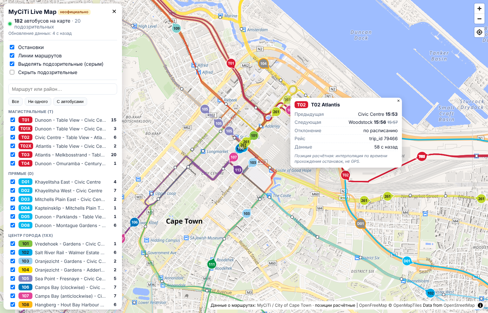

# MyCiTi Live Map

> **Disclaimer.** This is an **unofficial** hobby project. It is **not affiliated with,
> endorsed by, or connected to the City of Cape Town or MyCiTi** in any way. All timetable and network
> data belongs to the City of Cape Town and is taken from the public website
> [myciti.org.za](https://www.myciti.org.za). **Bus positions shown on the map are estimated**
> (interpolated from published stop passing times along the route shape). They are *not* GPS positions
> and may be inaccurate or wrong.
>
> **Дисклеймер.** Неофициальный проект, не связан с City of Cape Town и MyCiTi. Данные принадлежат
> городу и берутся с открытого сайта myciti.org.za. **Позиции автобусов расчётные**, а не GPS:
> они могут быть неточными или неверными.

Карта автобусов MyCiTi (Кейптаун) в реальном времени. У MyCiTi нет официального API и GTFS-RT,
координат автобусов сайт не отдаёт. Зато страницы расписаний встраивают в HTML живые времена
прохождения остановок по каждому рейсу. По ним сервер рассчитывает, где сейчас автобус, интерполируя
его положение вдоль трассы маршрута.



## Запуск

Нужны Node.js ≥ 22 и pnpm 10.

```bash
pnpm install
```

```bash
pnpm dev
```

Откройте http://localhost:5173. Vite проксирует `/api` на сервер `:3000`. Первый полный цикл опроса
занимает около полутора минут, автобусы появляются по мере загрузки маршрутов.

Через Docker:

```bash
docker compose up --build
```

Карта будет на http://localhost:8080 (порт задаётся через `WEB_PORT`). Nginx (образ без root, порт 8080
внутри) раздаёт фронтенд и проксирует `/api` в контейнер сервера. Кеш (сеть маршрутов и последние
снимки) хранится в томе `myciti-data`.

Настройки читаются из `.env` в корне или в `server/`, образец в [`.env.example`](.env.example):
интервалы опроса, список маршрутов (`ROUTES`, по умолчанию все), потолок запросов в минуту, таймауты,
backoff, пороги движка, срок годности данных, лимиты API.

Тесты и сверка с сайтом:

```bash
pnpm test
```

```bash
pnpm verify
```

`pnpm verify` требует запущенного сервера. Для маршрутов 101, T01 и D01 он скачивает страницы
расписаний (по одному запросу на маршрут) и проверяет каждый автобус на карте: текущий момент должен
лежать между опубликованными временами остановок, между которыми стоит автобус, а сам автобус — между
этими остановками на трассе. Другие маршруты: `pnpm verify -- --routes 101,T04`.

## Как это работает

```
myciti.org.za ──(вежливый опрос)──► server: parser → stores → engine ──► /api/*, SSE ──► web: engine + анимация
```

### Источники данных

| Что | Где | Как часто |
|---|---|---|
| Сеть: маршруты, трассы, остановки | `/en/routes-stops/route-stop-station-map/`, переменные `map_routes`, `map_stops`, `map_shapes` | раз в сутки, кеш на диске |
| Живые времена по рейсам маршрута | `/en/timetables/route-timetables/?route=ID`, переменная `timetable` | не чаще раза в 60 с на страницу |

JS-литералы извлекаются из inline-скриптов сканированием скобок с учётом строк и комментариев, затем
разбираются через `JSON.parse`, при неудаче через JSON5. Код страницы никогда не исполняется (`eval`
нет). Структуры проверяются zod-схемами. Если разметка изменилась, ошибка видна в `/api/health`.

### Что выяснилось при разведке (06.11.2026)

- Остановки внутри `trips[].stops` отсортированы по **живому** `time`, а не по ходу маршрута. Порядок
  следования восстанавливается по `static_time`, а при равенстве — по последовательности из `map_routes`.
- Живые времена вдоль маршрута бывают **немонотонны**: дальняя остановка иногда отмечена раньше
  предыдущей (преждевременная отметка, на 1–13 мин).
- Сдвиг на один рейс встречается не только утром на 101. На D01 днём были рейсы с отклонением
  +100…+170 мин, на T01 — с −105 мин.
- У будущих рейсов всегда `Scheduled`, живые данные появляются, когда рейс начался. Бывают смешанные
  рейсы: начало `Scheduled`, дальше `Live` (автобус «подхватили» по ходу).
- `start_time` — живое время первой остановки. `start_timestamp` — секунды от 1988-06-28 00:00 SAST
  (скрипт сайта строит дату от этого дня), то есть просто время суток; не используется.
- У сайта есть JSON-эндпоинт `/ajax/?action=where-is-my-bus&lat=…&lng=…`: четыре ближайшие остановки
  со всеми отправлениями дня, настоящим epoch-`timestamp` и флагом `Live`, но без `trip_id`. Для карты
  он не годится (нужны сотни вызовов), но удобен для сверки. Хост `api.myciti.org.za` отвечает
  «Invalid api version»: бэкенд мобильного приложения, контракт неизвестен. Статический GTFS
  (`google_transit.zip`) с сайта исчез, GTFS-RT не публикуется.
- У маршрута с единственным направлением 1 (213) `timetable` — объект `{"1": {...}}`, а не массив.
- `map_routes` — массив. `map_stops[].station` у всех `false`. В `directions[].stops` бывают повторы
  (петли, `CIVIC CIVIC` в конце).
- Трасса 237/0 проходит в 350–414 м от пяти своих остановок. У остальных маршрутов остановки не дальше
  ~170 м от трассы.

### Расчёт позиции (`shared/`, общий для сервера и клиента)

1. **Порядок и время.** Остановки упорядочиваются по плану. Время `HH:MM` переводится в абсолютное:
   день сервиса определяется по полю `day` (название дня недели) и ночному разрыву в расписании;
   рейсы через полночь «разворачиваются», например 23:58 → 00:05 следующего дня.
2. **Устойчивое выпрямление времён.** Среди наблюдений выбирается самая большая непротиворечивая
   (неубывающая) подпоследовательность. `Live`-остановки весят больше чисто плановых, а при равной длине
   выбирается вариант, где задержка меняется плавнее. Выброшенные отметки восстанавливаются интерполяцией
   задержки соседей, поэтому результат монотонен по построению. Пример D01/106900: KUYASA +20, LNDLA +5,
   DIBANA +20 → выбросом признаётся LNDLA, её время пересчитывается с задержкой +20.
3. **Одинаковые минуты.** Соседние остановки с одинаковым временем распределяются внутри минуты
   пропорционально расстоянию, то есть с равномерной скоростью.
4. **Привязка к трассе.** Каждая остановка проецируется на трассу направления (`route_points`) с
   монотонным продвижением. Это динамическое программирование по кандидатам: по одному на каждый
   проход трассы мимо остановки, что корректно обрабатывает петли и маршруты «туда-обратно».
5. **Интерполяция.** Находится `i`, для которого `fit[i] ≤ now < fit[i+1]`. Позиция — точка на трассе на
   расстоянии `d[i] + f·(d[i+1] − d[i])`. За 5 мин до отправления автобус стоит на начальной конечной,
   ещё 1 мин после прибытия — на конечной, потом скрывается.
6. **Suspect.** Если |fit − static| > 30 мин хотя бы на одной Live-остановке, рейс помечается как
   подозрительный: он рисуется серым с оранжевой обводкой и исключается из медианы отклонений в
   `/api/health`.
7. **Один автобус на конечной.** Если рейс A закончился на остановке, а рейс B того же маршрута стартует
   с той же (или ближе 250 м) остановки в пределах 10 мин, показывается один маркер B («прибыл рейсом A»).
8. **Срок годности данных.** Позиция между опросами — прогноз по последнему снимку. Если снимок старше
   `MAX_DATA_AGE_MIN` (20 мин: сайт недоступен, опрос сломался), автобус с карты убирается, а не едет
   «по расписанию» дальше.

Клиент получает подготовленные stop-times и считает позиции сам примерно 20 раз в секунду. Расчётная
позиция честная, но дёрганая: на каждом перегоне своя постоянная скорость (времена с точностью до
минуты), а каждый новый опрос сдвигает оценку. Поэтому маркер не рисуется в расчётной точке, а едет за
ней как автомобиль (`followerStep` в `shared/`): никогда не сдаёт назад, скорость не выше 108 км/ч,
ускорение не больше 2 м/с², торможение 4 м/с², а разрыв с оценкой закрывается постепенно (за ~12 с) поверх
собственной скорости перегона. Скачок больше 1,5 км вперёд или 400 м назад считается новым местом,
туда маркер переносится сразу. В попапе показаны обе скорости: отображаемая и подразумеваемая
временами перегона. Часы клиента подстраиваются под серверные по медиане последних отметок времени
(`ClockSync`), поэтому задержки сети не дёргают позиции. На слабом устройстве частота кадров сама
снижается до 10–7 в секунду вместо рывков; при `prefers-reduced-motion` анимация идёт 4 раза в секунду.
Вкладка, вернувшаяся из фона, и восстановленное соединение сразу пересинхронизируются.

### Бережная нагрузка на сайт

- User-Agent с названием проекта и ссылкой на репозиторий.
- `robots.txt` проверяется при старте и раз в сутки по правилам RFC 9309: 4xx — ограничений нет,
  5xx или недоступен — ничего не запрашиваем и повторяем позже. `Crawl-delay` учитывается. На 06.11.2026
  `robots.txt` отвечает 404.
- Не больше 2 запросов одновременно, между стартами запросов не меньше 1 с. Первые запросы
  распределяются равномерно по минуте.
- Адаптивный интервал для каждого маршрута:
  - идут Live-рейсы или по расписанию идёт сервис на маршруте с живыми данными — раз в 60 с
    (`POLL_LIVE_SEC`, меньше 60 задать нельзя);
  - сервис идёт, но живых данных у маршрута сегодня нет — раз в 180 с;
  - сейчас рейсов нет — пауза до «следующего отправления минус 10 мин» (не дольше часа);
  - рейсы на сегодня закончились — ночная пауза до утра.
- Отсчёт интервала ведётся от фактического старта запроса, поэтому одна страница не запрашивается
  чаще раза в 60 с.
- Жёсткий потолок `MAX_REQUESTS_PER_MIN` (45) запросов в скользящую минуту, что бы ни решил планировщик.
- Сайту дорого обходится не трафик, а генерация страницы: T01 на 5 000 строк собирается у него 10–15 с.
  Поэтому, когда средний ответ сайта дольше `SLOW_ORIGIN_MS` (15 с), интервалы опроса растягиваются
  пропорционально, до `SLOW_ORIGIN_MAX_FACTOR` (×3). Коэффициент виден в `/api/health`.
- Таймауты 45 с. Экспоненциальный backoff с джиттером для маршрута. На 429/503 весь хост ставится на
  паузу с учётом `Retry-After`. После серии ошибок 5xx или таймаутов тоже включается пауза для всего хоста.
- Ответы больше `MAX_BODY_MB` (48 МБ) обрываются, редиректы на другой хост не принимаются: парсер никогда
  не видит чужую страницу.
- Снимки маршрутов сохраняются на диск, поэтому после перезапуска сервер продолжает по прежнему
  графику и не перекачивает все страницы.

Замер 06.11.2026 днём (все 47 маршрутов, 12 минут работы): 40 запросов в минуту, 0 ошибок. Это около
5 МБ в минуту по сети (gzip) или ~150 МБ HTML после распаковки: страница T01 весит 8.6 МБ.
Полный цикл по всем маршрутам занимает 70–90 с, поэтому фактически каждая страница запрашивается раз
в 60–90 с. Ночью запросов почти нет. Чтобы снизить нагрузку, ограничьте `ROUTES` или увеличьте
`POLL_LIVE_SEC`.

### История наблюдений (сбор фактических данных)

У сайта нет истории: страница маршрута показывает один день, а время остановки перезаписывается на
месте по мере движения автобуса. Открытых архивов фактического движения MyCiTi тоже нет: город
публикует только GIS-слои маршрутов и остановок, статический GTFS с сайта исчез, в Mobility Database
фида Кейптауна нет. Поэтому сервер сам ведёт журнал: каждое **изменение** опубликованного времени по
каждой остановке дописывается в файл за день сервиса (`OBSERVATIONS=true` по умолчанию,
каталог `DATA_DIR/observations`, в Docker это том `myciti-data`).

```
data/observations/
  2026-11-07.jsonl      # текущий день сервиса, дописывается при каждом опросе
  2026-11-06.jsonl.gz   # закончившиеся дни сжимаются (через сутки после окончания)
```

Три вида записей (JSON Lines, время в секундах epoch):

| `k` | Когда | Поля |
|---|---|---|
| `poll` | каждый опрос страницы маршрута | `t`, `r` (маршрут), `day`, `sd` (дата сервиса), `trips`, `live`, `changed` |
| `trip` | рейс впервые встретился в этот день сервиса (его расписание) | `t`, `r`, `d` (направление), `trip`, `stops: [[stopId, sched], …]` по ходу движения |
| `obs` | опубликованное время остановки изменилось или впервые отличилось от расписания | `t`, `r`, `d`, `trip`, `seq` (номер остановки по ходу), `stop`, `sched`, `time`, `live` (1/0) |

Остановки по расписанию, время которых совпадает с плановым, не несут информации и не пишутся, пока
не изменятся. Последнее `obs` со `live: 1` по остановке — фактическое время прохождения, более
ранние значения — прогнозы сайта (у рейса в пути все остановки помечены `Live`, и время будущих
остановок меняется от опроса к опросу). При старте файлы текущего и вчерашнего дня перечитываются,
поэтому после перезапуска в журнал попадают только настоящие изменения, а не весь снимок заново.
Объём: порядка 5–30 МБ в день в несжатом виде, в 10 раз меньше после сжатия. `OBSERVATIONS_KEEP_DAYS`
удаляет файлы старше N дней (0 — хранить всегда). Состояние журнала видно в `/api/health`
(`observations`: открытые даты, записано записей и байт, последняя ошибка, размер на диске).

Что с этим делать потом:

```bash
pnpm observations -- summary
```

```bash
pnpm observations -- export --from 2026-11-07 --to 2026-11-20 --out stop-times.csv
```

```bash
pnpm observations -- report --from 2026-11-07 --routes 101,T01 --csv punctuality.csv
```

`summary` показывает, что собрано по дням (опросы, рейсы, отслеженные рейсы, фактические времена).
`export` даёт по строке на каждую пару «рейс–остановка»: плановое и фактическое время (локальное и UTC),
отклонение в минутах, когда остановка впервые стала `Live` (для рейсов, завершившихся до начала сбора, это
момент первого опроса), сколько раз менялось значение, отслеживался ли рейс вообще. Имена остановок и направлений берутся из кеша сети `DATA_DIR/network.json`, если он есть.
`report` считает пунктуальность по маршруту, направлению и часу отправления: рейсов по расписанию и
отслеженных, медиана отклонения на первой и последней остановке, 85-й перцентиль, доля прибытий в
окне −1…+5 мин, медиана отношения фактического времени хода к плановому. Все вычисления — чистые
функции в `server/src/observation-report.ts`, их можно использовать из своего кода.

Через неделю-две таких данных можно будет не только показывать текущие времена с сайта, но и
учитывать статистику: типичное время хода по перегону в этот час и день недели (вместо постоянной
скорости между двумя опубликованными минутами), типичное отклонение рейса от расписания, пока
живых отметок ещё нет, и качество прогнозов сайта (насколько прогноз будущей остановки обычно
расходится с фактом). Это этап 2 ниже.

### API

| Метод | Что возвращает |
|---|---|
| `GET /api/network` | маршруты (цвета, направления, трассы `[lng, lat]`), остановки; кеш + ETag |
| `GET /api/trips/live?routes=101,T01` | живые рейсы около текущего момента: подготовленные stop-times (`sched`, `raw`, `fit`, `dist`, `outlier`), время получения данных, параметры движка; `&all=1` — все рейсы дня |
| `GET /api/vehicles?routes=…` | GeoJSON рассчитанных позиций: маршрут, направление, `bearing`, предыдущая и следующая остановка, отклонение, `speedKmh` перегона, suspect, возраст данных |
| `GET /api/stream` | SSE: `route` (обновление маршрута с его рейсами), `network`, `ping` (время сервера) |
| `GET /api/health` | общий статус, сеть, `robots.txt`, счётчики HTTP-клиента (среднее время ответа, запросов за минуту, коэффициент замедления), состояние журнала наблюдений (`observations`), по каждому маршруту: режим опроса и причина, возраст данных, последняя ошибка и HTTP-статус, время ответа, число рейсов, автобусов, suspect, медиана отклонения |

API только для чтения. Параметр `routes` проверяется по шаблону идентификатора маршрута (не больше 200
значений, чужие строки отбрасываются и никогда не возвращаются обратно). Поток `/api/stream` принимает не
больше `MAX_SSE_CLIENTS` соединений, клиент, переставший читать, отключается при 1 МБ в буфере, а
`Access-Control-Allow-Origin` отражает только origin из `CORS_ORIGIN`. Тело запроса ограничено 16 КБ,
внутренние ошибки наружу не уходят. В Docker nginx добавляет `limit_req` (10 запросов/с на адрес),
`limit_conn` (6 потоков на адрес), запрет фреймов, `nosniff`, `Referrer-Policy`, `Permissions-Policy` и
Content-Security-Policy, которая разрешает скрипты только со своего origin, а сеть — только к своему
origin и к тайлам OpenFreeMap. Оба контейнера работают без root, без capabilities, с файловой системой
только для чтения, лимитами памяти и ротацией логов.

## Структура

```
shared/   типы и движок: время/часовой пояс, геометрия, привязка к трассе, выпрямление времён, позиции
server/   Fastify: parser/, http/ (fetcher, robots), stores/ (сеть, снимки, журнал наблюдений), poller.ts, api.ts,
          observation-report.ts; scripts/verify.ts, scripts/observations.ts
web/      React + Vite + MapLibre GL (OpenFreeMap / OSM): анимация, панель фильтров, попапы
fixtures/ снимки страниц сайта для тестов (ключ Google Maps из них вырезан)
```

Тесты: парсеры на фикстурах; движок (полночь, suspect, выбросы, одинаковые минуты, петли, конечные,
срок годности); синхронизация часов; интеграционный тест на реальных страницах 101, T01 и D01 (каждый
автобус стоит между остановками, времена которых окружают текущий момент); HTTP-клиент (параллельность,
интервалы, бюджет в минуту, лимит размера, чужие редиректы, 429, `robots.txt`); планировщик опроса и
замедление при медленном сайте; проверка параметров API и CORS; журнал наблюдений (что пишется при первом
и повторных снимках, восстановление после перезапуска, сжатие и ротация файлов, реконструкция дня и отчёт).

## Ограничения

- **Позиция расчётная.** Это интерполяция по времени между остановками, а не GPS. Точность времени на
  сайте — минута. Стоянки на остановках и пробки внутри перегона не видны.
- **Качество данных.** Система сайта иногда привязывает автобус к соседнему рейсу (сдвиг ±60 мин и
  больше) и ставит отметки не по порядку. Движок это сглаживает и помечает, но угадать реальность не
  может. Номеров машин на сайте нет, поэтому «один автобус на конечной» — эвристика.
- **Только Live-рейсы.** Рейсы без живых данных на карте не показываются. Часть маршрутов в отдельные
  дни не отслеживается вовсе.
- **Между опросами** позиция — прогноз по последнему снимку. Если опрос маршрута не удаётся, данные
  стареют: маркеры становятся полупрозрачными через 10 мин и исчезают через `MAX_DATA_AGE_MIN` (20 мин),
  возраст данных виден в попапе и `/api/health`.
- **Неофициальный источник может сломаться** в любой момент: изменится разметка или появятся
  ограничения доступа. Парсер падает с понятной ошибкой в `/api/health`, а не рисует мусор.
- Переход через полночь и выбор дня сервиса покрыты тестами на синтетике. Вживую на ночных рейсах
  (06.11 последние рейсы заканчивались около 23:30) это пока не проверено.
- Часовой пояс — Africa/Johannesburg (UTC+2, без перехода на летнее время). Внутри дня сервиса смещение
  считается постоянным.

## Этап 2 (планы)

- Использовать накопленную историю в движке: медианное время хода по перегону и час/день недели как
  профиль скорости внутри перегона вместо равномерной; ожидаемое отклонение рейса, пока живых отметок
  нет; оценка качества прогнозов сайта и `suspect`-порога по фактическим распределениям.
- Отчёт пунктуальности без suspect-рейсов и по дням недели (сейчас `pnpm observations -- report`
  считает по всем отслеженным рейсам).
- PostgreSQL вместо файлов JSON Lines, если объём или запросы перерастут скрипт.
- GTFS-RT `VehiclePositions` и `TripUpdates` (protobuf) для сторонних инструментов.
